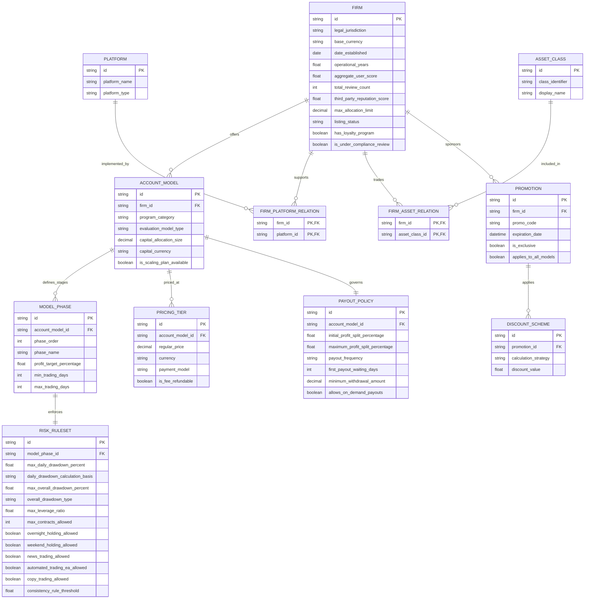

# Especificación Técnica: Modelo Conceptual de Datos para Trading Evaluado

Este documento recoge el modelo de datos conceptual neutro y los contratos de consulta derivados del análisis de capturas de red y esquemas de evaluación en firmas de trading financiado (Prop Firms).

---

## 1. Arquitectura de Transporte e Interfaces de Consulta

Las plataformas modernas de comparación de firmas de fondeo y cuentas de trading evaluado estructuran su intercambio de información bajo los siguientes patrones:

- **Protocolo RPC / Streaming:** Procedimientos tipados (ej. tRPC) sobre HTTP/2 con serialización extendida para preservar tipos nativos (`Date`, `Decimal`, `Set`).
- **Consultas Agregadas:** Batching de procedimientos en una única llamada para recuperar simultáneamente entidades principales, filtros taxonómicos y marcas de tiempo de actualización.

### 1.1. Procedimientos Clave de Consulta

| Procedimiento | Método | Parámetros de Entrada (`input`) | Propósito |
| :--- | :---: | :--- | :--- |
| `firm.listPopular` | `GET` | `firmCategory`, `filter: {...}` | Catálogo de firmas filtradas por parámetros multicriterio. |
| `firm.listTopAllPopular` | `GET` | `limit: number` | Entidades con mayor adopción o popularidad relativa. |
| `firmLists.getAssetOptions` | `GET` | `firmCategory: enum` | Diccionario de clases de activos disponibles por categoría. |
| `promo.listExclusiveFiltered` | `GET` | `limit: number`, `search: string` | Catálogo de promociones y descuentos aplicables. |
| `entityLastUpdated.get` | `GET` | *None* | Verificación de marcas temporales de sincronización. |

### 1.2. Contrato de Filtrado Multicriterio

```json
{
  "firmCategory": "forex | futures | crypto | perpetuals",
  "filter": {
    "assets": ["string"] | null,
    "instruments": ["string"] | null,
    "platformIds": ["string"] | null,
    "programType": ["1 Step" | "2_Steps" | "3_Steps" | "Instant"] | null,
    "countryFeatureIds": ["string"] | null,
    "maxAllocation": number | null,
    "maxAllocationMax": number | null,
    "trustPilotScore": number | null,
    "reviewScore": number | null,
    "yearsInOperation": number | null
  }
}
```

---

## 2. Modelo Entidad-Relación Conceptual Neutro (ERD)



---

## 3. Diccionario de Datos de Entidades Principales

### 3.1. FIRM (Entidad Evaluadora)
- `id`: CUID o UUID identificador único.
- `legal_jurisdiction`: Código de país ISO 3166-1 alpha-2 de registro corporativo.
- `base_currency`: Divisa operativa base (ej. `USD`, `EUR`).
- `date_established`: Timestamp de inicio de operaciones.
- `max_allocation_limit`: Techo nominal de fondeo acumulado admisible por operador (ej. $600,000 - $2,000,000).
- `listing_status`: `['listed', 'under_review', 'delisted']`.
- `aggregate_user_score`: Puntuación normalizada de usuarios (0.0 a 5.0).
- `third_party_reputation_score`: Puntuación externa agregada (Trustpilot/auditorías).

### 3.2. ACCOUNT_MODEL (Modelo de Cuenta)
- `program_category`: `['forex_cfd', 'futures', 'crypto', 'perpetuals']`.
- `evaluation_model_type`: `['1_Step', '2_Steps', '3_Steps', 'Instant']`.
- `capital_allocation_size`: Saldo nominal de la cuenta ($5,000 a $450,000+).
- `is_scaling_plan_available`: Disponibilidad de incremento progresivo de capital según rendimiento.

### 3.3. RISK_RULESET (Reglas de Riesgo y Operativa)
- `daily_drawdown_calculation_basis`: 
  - `balance_based`: Calculado sobre el balance fijado al cierre de la sesión anterior.
  - `equity_based`: Calculado sobre el pico de equidad flotante intradía.
- `overall_drawdown_type`:
  - `static`: Drawdown absoluto fijo calculado desde el balance inicial.
  - `relative`: Recalculado respecto al balance cerrado.
  - `trailing_eod`: Sigue el balance positivo al cierre del día (End of Day).
  - `trailing_intraday`: Sigue dinámicamente el High-Water Mark en tiempo real.
- `max_daily_drawdown_percent`: Umbral de pérdida diaria (rango: 3% - 6%).
- `max_overall_drawdown_percent`: Umbral de pérdida total (rango: 6% - 12%).
- `consistency_rule_threshold`: Umbral porcentual máximo de rentabilidad atribuible a un único día (ej. 30%, 50%).

### 3.4. PAYOUT_POLICY (Condiciones de Liquidación)
- `initial_profit_split_percentage`: Reparto inicial de ganancias a favor del trader (70% - 90%).
- `maximum_profit_split_percentage`: Reparto máximo alcanzable tras escalado (hasta 100%).
- `payout_frequency`: `['weekly', 'biweekly', 'monthly', 'on_demand']`.
- `first_payout_waiting_days`: Período de carencia en días antes de habilitar el primer retiro (0 a 30 días).

---

## 4. Dimensiones Clave para Comparación de Entidades

1. **Mercado y Activos:** Clases de activos negociables (`FX`, `Índices`, `Metales`, `Energía`, `Agrícolas`, `Cripto`).
2. **Estructura de Evaluación:** Fases de examen requeridas, límites de tiempo o ausencia de límite temporal.
3. **Mecánica de Drawdown:** Drawdown estático vs. trailing intradía/EOD; base balance vs. equidad.
4. **Restricciones Operativas:** Posiciones en fines de semana (*weekend holding*), operativa durante noticias de alto impacto, trading algorítmico / EAs.
5. **Condiciones Económicas:** Costo de suscripción / tasa única, tasa reembolsable en primer retiro, frecuencia de pago y escala de reparto.
